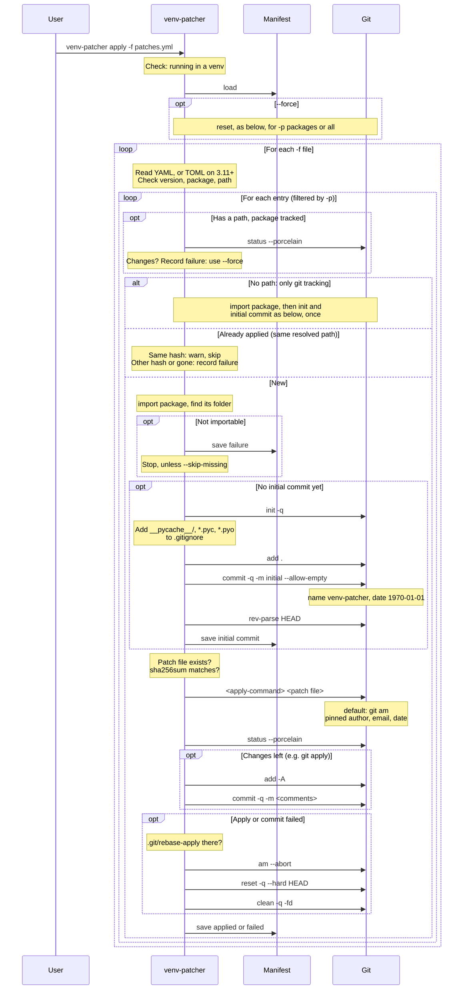
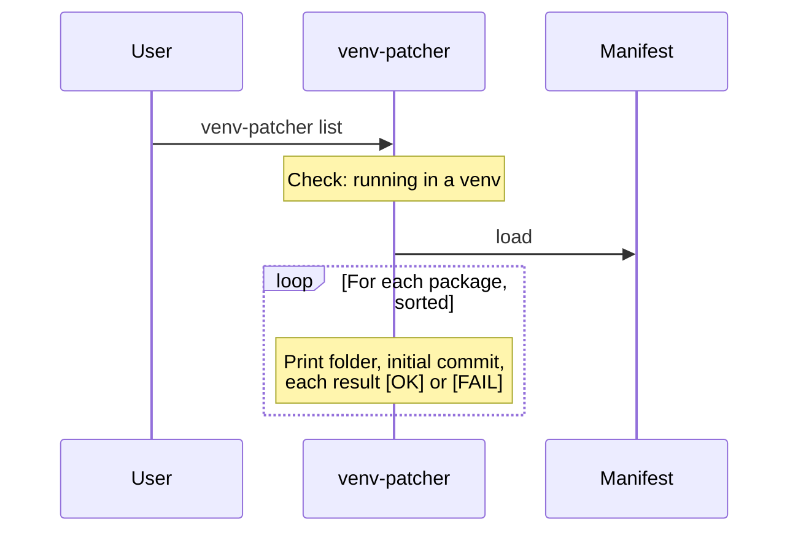
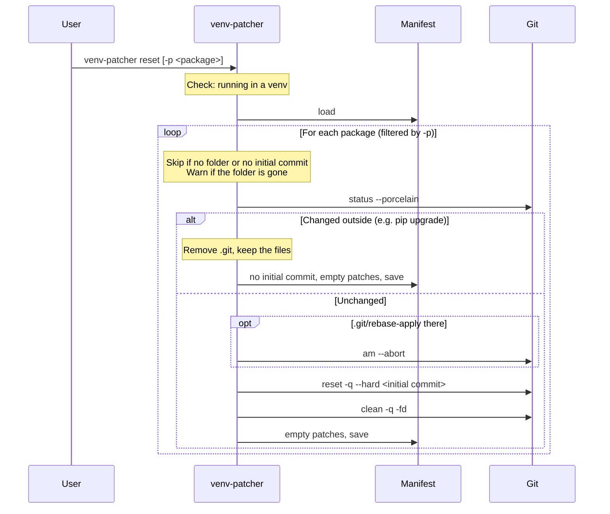

# Git call diagrams

Each diagram shows the git commands one `venv-patcher` command runs, in
order. It is the fastest way to see what a command really does.

Every git call runs in the package folder. Each one also gets
`gc.auto=0` and `maintenance.auto=false`.

---

## apply

---

## list

`list` runs no git command. It only reads the manifest.

---

## reset

