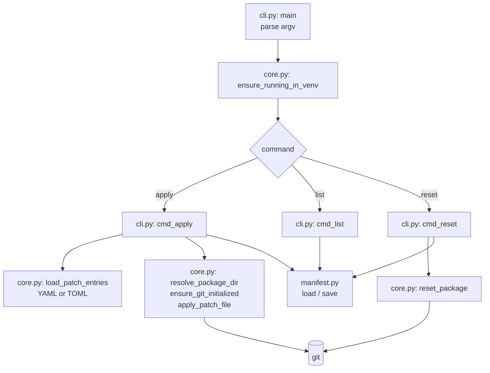

# Architecture

This page is for people who want to change venv-patcher. It shows how the
code is built and why.

## Goals

- **Plain git underneath.** A patched package is a normal git repository.
  You can look at it with normal git commands.
- **Repeatable.** The same input gives the same commits. Names and dates
  are pinned.
- **Record everything.** Each result goes to the manifest right away, also
  a failure.
- **No surprises.** A changed patch is never applied on top of the old one.

## How a command runs

1. `cli.main` parses the command line with `argparse`. Then it checks that
   it runs in a venv.
2. Each command has one `cmd_<name>` function in `cli.py`.
3. `cmd_apply` reads each patches file and handles each entry in
   `_apply_one`.
4. `core.py` does the work on disk: import, git, hashes, file parsing.
5. `manifest.py` loads and saves the manifest.

## Modules

| Module | Role |
|---|---|
| `cli.py` | the command line, the three commands, and the steps of one entry |
| `core.py` | finding packages, running git, reading patches files, hashes |
| `manifest.py` | where the manifest is, and how it is read and written |
| `__init__.py` | the version |

### `cli.py`

| Function | Role |
|---|---|
| `build_parser` | the `argparse` parser: commands, options, help texts |
| `main` | the entry point; checks the venv and picks the command |
| `cmd_apply`, `cmd_list`, `cmd_reset` | one per command |
| `_apply_one` | all steps for one entry, in order |
| `_reset_packages` | used by `reset` and by `apply --force` |

### `core.py`

| Function | Role |
|---|---|
| `ensure_running_in_venv` | stops outside a venv |
| `resolve_package_dir` | imports a package and finds its folder |
| `ensure_git_initialized` | `git init` and the initial commit |
| `apply_patch_file` | runs the apply command and commits the rest |
| `reset_package` | `git reset --hard` and `git clean` |
| `load_patch_entries` | reads and checks a patches file |
| `sha256_of` | the hash of a patch file |

## Key decisions

### git, not a copy

venv-patcher could keep a copy of each package. It uses git instead:

- `reset` is one `git reset --hard`.
- You can look at what changed with `git log` and `git diff`.
- `git am` and `git apply` already handle patches well.

### Pinned identity

Commits get a fixed name, email and date. The fallback date is 1970. So the
initial commit only depends on the package files. This makes problems easy
to compare between machines.

### git runs without maintenance

venv-patcher runs git many times in a row, in folders it does not own. It
turns off `gc.auto` and `maintenance.auto` for each call, with
`GIT_CONFIG_COUNT`. Otherwise git may start work in the background, and
leave lock files behind.

### The manifest lives in the venv

The manifest is in site-packages. So each venv has its own, and you never
pass a path to `list` or `reset`. Deleting the venv removes everything.

### Save after each step

`apply` saves the manifest after each change. If a later step fails, or
the process is stopped, the manifest still says what happened.

### TOML only on Python 3.11 or newer

`tomllib` is part of Python since 3.11. venv-patcher still supports 3.9.
So it reads TOML only when `tomllib` is there. On older Pythons a `.toml`
file stops with a clear error.

### Small functions

`complexipy` limits each function to a complexity of 5. That is why
`_apply_one` is split into many small helpers, one per step.

## Git calls

[Git call diagrams](diagrams.md) show the git commands of each command, in
order. Update them when a command's git calls change.
