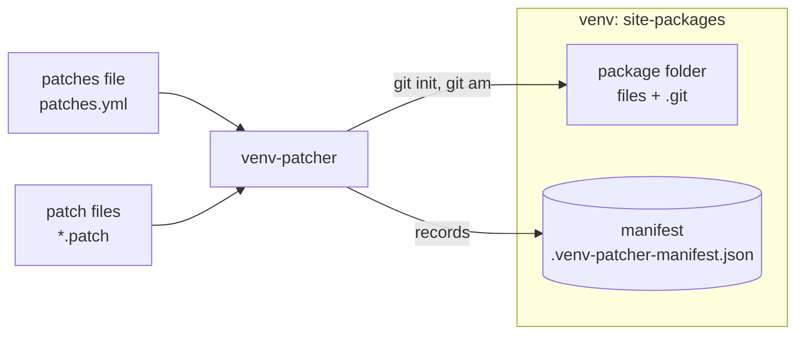
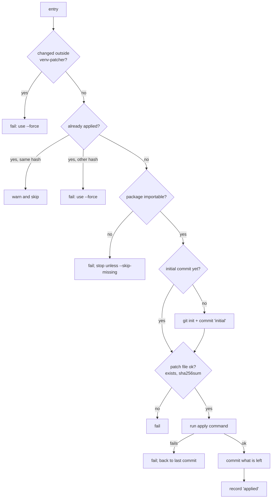
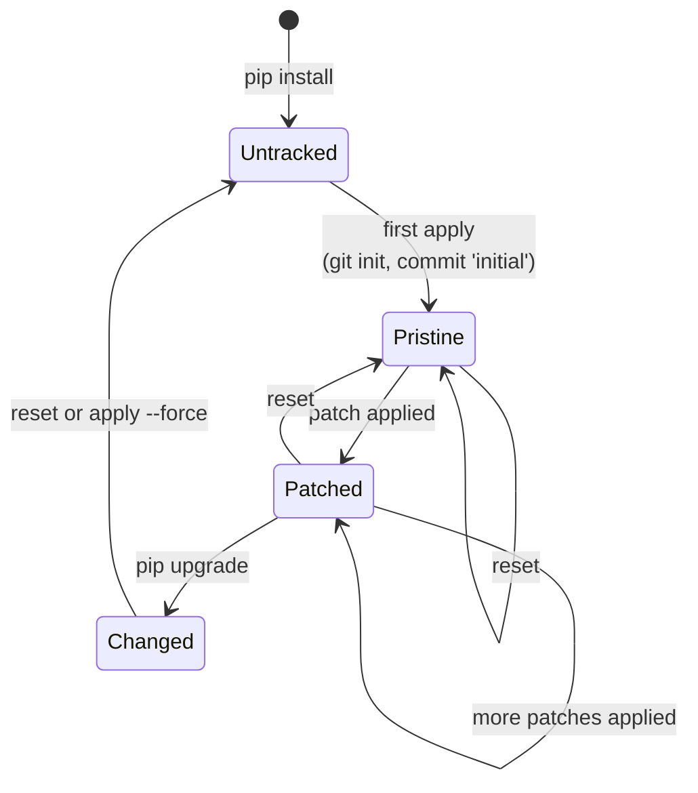

# How it works

This page explains what venv-patcher does inside. You do not need it for
daily use. It helps when something goes wrong.

[Git call diagrams](../architecture/diagrams.md) show the exact git commands
of each command.

## The picture

You write the patches file and the patch files. venv-patcher changes the
package folders and records what it did in the manifest.

## Where things live

| Thing | Where | Who writes it |
|---|---|---|
| patches file | your project, for example `patches.yml` | you |
| patch files | your project, for example `patches/` | you |
| git repository of a package | `site-packages/<package>/.git` | venv-patcher |
| `.gitignore` of a package | `site-packages/<package>/.gitignore` | venv-patcher |
| manifest | `site-packages/.venv-patcher-manifest.json` | venv-patcher |

Everything venv-patcher writes is inside the venv. Delete the venv, and it
is all gone.

## Apply

For each entry of the patches file, in order:

1. **Find the patch file.** A relative `path` is relative to the patches
   file.
2. **Check for outside changes.** If the package files differ from its last
   commit, pip or someone else changed them. Fail, and point to `--force`.
3. **Skip a repeat.** If the manifest says this patch file is already
   applied, compare its hash:
   - the same: print a warning and skip it;
   - different: fail, and tell you to use `--force`.
4. **Find the package folder.** Import the package and take its folder.
   If that fails, record the error and stop, or go on with
   `--skip-missing`.
5. **Make the initial commit**, the first time only:
   - `git init`;
   - add `__pycache__/`, `*.pyc` and `*.pyo` to `.gitignore`;
   - `git add .` and commit as `initial`, with the pinned identity.
6. **Check the patch file.** It must exist. If `sha256sum` is set, the hash
   must match.
7. **Apply it.** Run the apply command with the patch file, in the package
   folder.
8. **Commit it.** If the apply command left changes (like `git apply`
   does), commit them. `git am` already made its own commit.

   If step 7 or 8 fails, the package goes back to its last commit. So a
   failed patch leaves nothing behind.
9. **Record it** in the manifest: `applied` with the hash, or `failed` with
   the error.

The manifest is saved after each step that changes it. So a failure is
recorded even if a later step crashes.

An entry without `path` only gets steps 4 and 5: find the package folder,
and make the initial commit. That sets up git, so you can start a patch in
the package folder.

## Why the commits are always the same

Every commit venv-patcher makes uses a pinned identity:

| | Set by | Fallback |
|---|---|---|
| name | `author` | `venv-patcher` |
| email | `email` | `venv-patcher@localhost` |
| date | `date` | `1970-01-01T00:00:00+00:00` |

It sets them for both the author and the committer. Your name and email
from `git config` are not used. So the same package files give the same
initial commit on every machine. And the same patch on top gives the same
patch commit.

> [!NOTE]
> `git am` takes the author and the author date from the patch file
> itself. The pinned values then only set the committer. The hash still
> stays the same, because the patch file does not change.

## List

`list` reads the manifest and prints it. It runs no git command.

## Reset

For each package in the manifest (or only those given with `-p`):

If its files differ from the last commit (after a pip upgrade, say), a
hard reset would put back old files. So `reset` keeps the files, drops the
git history and empties the patch list. Otherwise:

1. End a `git am` that stopped half way, if there is one.
2. `git reset --hard <initial commit>`
3. `git clean -fd`, to remove files a patch added.
4. Empty the patch list of the package in the manifest.

The git repository and the initial commit stay. The next `apply` builds on
them again.

## Apply with `--force`

`apply --force` first runs a reset, then a normal apply. Without `-p`, it
resets **every** package in the manifest, also those that are not in the
patches file.

## A package's life

## What it does not do

- It does not patch `.py` files that sit right in site-packages. Only
  package folders.
- It does not apply patches again by itself after a pip upgrade. It tells
  you to. See [Upgrade a patched package](../guides/upgrade.md).
- It does not touch your project's git repository.
